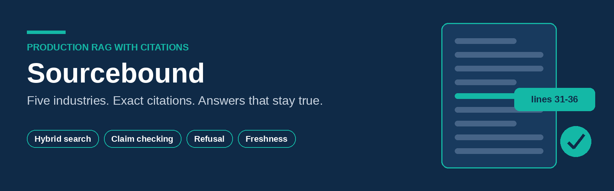
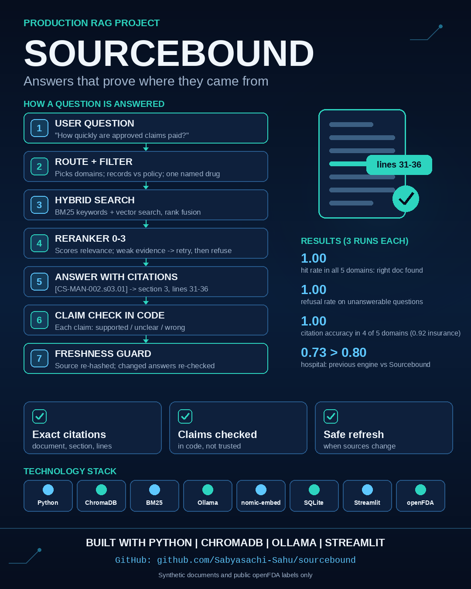
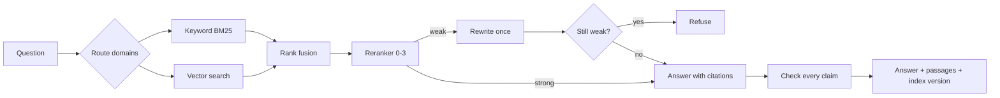
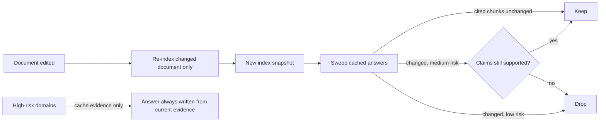

<p align="center">
  
</p>

# Sourcebound

**Production RAG with exact citations, claim checking and safe refresh.**
Answers that can prove where they came from, and stay true when documents change.

> ⚠️ **Synthetic documents and public openFDA drug labels only.** Not medical, legal or
> financial advice. No client data or client code.

<p align="center">
  
</p>

## Why

A citation proves a source exists, not that the sentence next to it is true. Embedding
search blurs the exact codes and numbers that policies are made of. And a cached answer
that was right yesterday can be wrong today. Sourcebound addresses all three.

## What it does

| Area | How |
|---|---|
| Sources | 5 domains, 1,200+ documents: openFDA labels, synthetic patient records, policies, SOPs, data specifications |
| Generated documents | Written by a model from briefs; every planted fact checked word for word; human-reviewed |
| Chunking | Never crosses a heading; keeps file line numbers |
| Retrieval | BM25 + vector search, reciprocal rank fusion, metadata filters, model reranker (0 to 3) |
| Citations | `[chunk ID]` resolved to domain, document, section and lines, with the supporting sentence |
| Verification | Each cited claim checked in code: supported, unclear or wrong |
| Refusal | Weak evidence → one rewritten query → refusal |
| Federation | Cross-industry questions search each domain and label every citation |
| Freshness | Chunk-hash validation of cached answers, claim re-check after changes, evidence-only caching for high-risk domains, source re-hash at query time, index snapshots, as-of-date answers |

## How a question flows



## When a document changes



## Results

10 questions per domain (8 answerable, 2 the documents cannot answer) and 4 cross-industry
questions, each run 3 times. Every gold answer was validated in its document first.

| Domain | Pass | Spread | Hit rate | Citation accuracy | Refusal rate | Latency p50 |
|---|---|---|---|---|---|---|
| Pharma | 0.80 | 0.00 | 1.00 | 1.00 | 1.00 | 6.1 s |
| Banking | 0.63 | 0.05 | 1.00 | 1.00 | 1.00 | 5.1 s |
| Hospital | 0.53 | 0.05 | 1.00 | 1.00 | 1.00 | 7.9 s |
| Insurance | 0.53 | 0.05 | 1.00 | 0.92 | 1.00 | 6.9 s |
| Data governance | 0.50 | 0.00 | 1.00 | 1.00 | 1.00 | 5.8 s |
| Cross-industry | 0.42 | 0.12 | 1.00 | 0.46 | - | 11.0 s |

- **Pass** is strict: every expected term in the answer **and** a citation to the expected document.
- **Hit rate** 1.00 everywhere: the right document always reached the model. The remaining
  gap is in generation (phrasing and which section is cited), not retrieval.
- **Ablation**: insurance without the reranker scored 0.60 at 1.6 s vs 0.53 at 6.9 s with it.
  The reranker did not earn its cost there; a cheaper cross-encoder is the next experiment.
- **Against the previous engine** on the same hospital questions and scorer: 0.73 → 0.80.

## Run it

Requires Python 3.11, [Ollama](https://ollama.com/) with `nomic-embed-text` and a chat model
(set `CHAT_MODEL` in `.env`).

```powershell
py -3.11 -m venv .venv
.\.venv\Scripts\Activate.ps1
pip install -r requirements.txt
python -m core.rag.index ingest
python -m core.rag.answer "How quickly are approved claims paid?" --pack insurance
python -m core.rag.evaluate validate
streamlit run app\pages\document_questions.py
```

Generated data (`data/`) is not committed. Drug labels come from
`python scripts\fetch_pharma_labels.py`; the synthetic patient records and the
data-governance documents come from the companion data platform
([LedgerLens](https://github.com/Sabyasachi-Sahu/capstone-platform/blob/main/LEDGERLENS.md)).

## Code

| Path | Purpose |
|---|---|
| `core/rag/` | Documents, index, retrieval, verification, answers, freshness, evaluation |
| `domain_packs/<domain>/docs/` | Source documents and the briefs they were generated from |
| `scripts/gen_pack_docs.py` | Generates documents from briefs, fact-checked |
| `tests/rag/` | Test questions per domain and cross-domain |
| `app/pages/document_questions.py` | Streamlit page |

## Lessons

1. A citation is a pointer, not a proof. Check the claim against the passage.
2. Measure every stage separately. Retrieval at 1.00 told me where not to look.
3. Run ablations. The reranker cost 4x latency and did not improve one domain.
4. Cache what is safe to cache. In high-risk domains that is evidence, not conclusions.
5. Test with the long real document. The chunker looped forever on one drug label.

## Author

**Sabyasachi Sahu**: personal learning and portfolio project. MIT licence.
